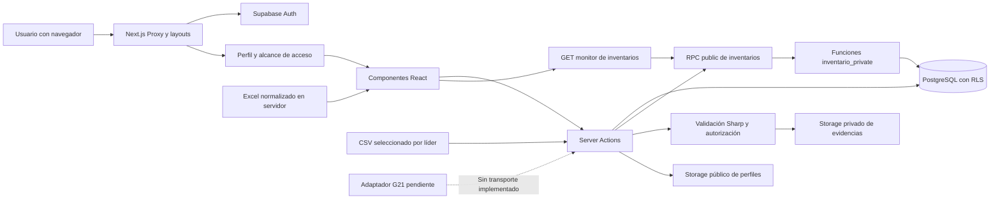
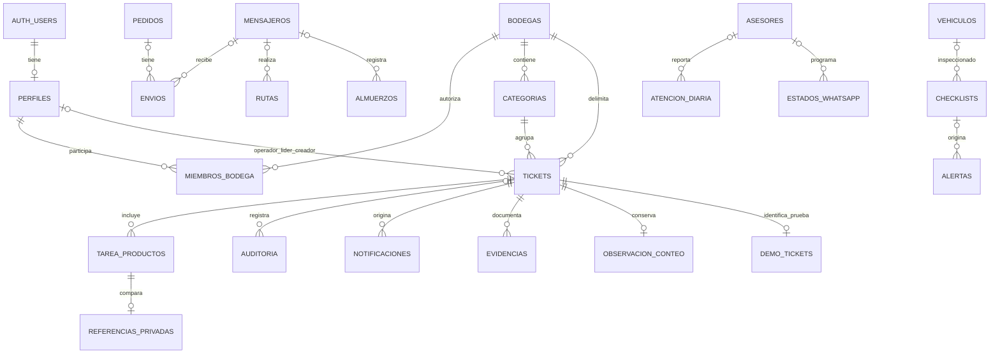
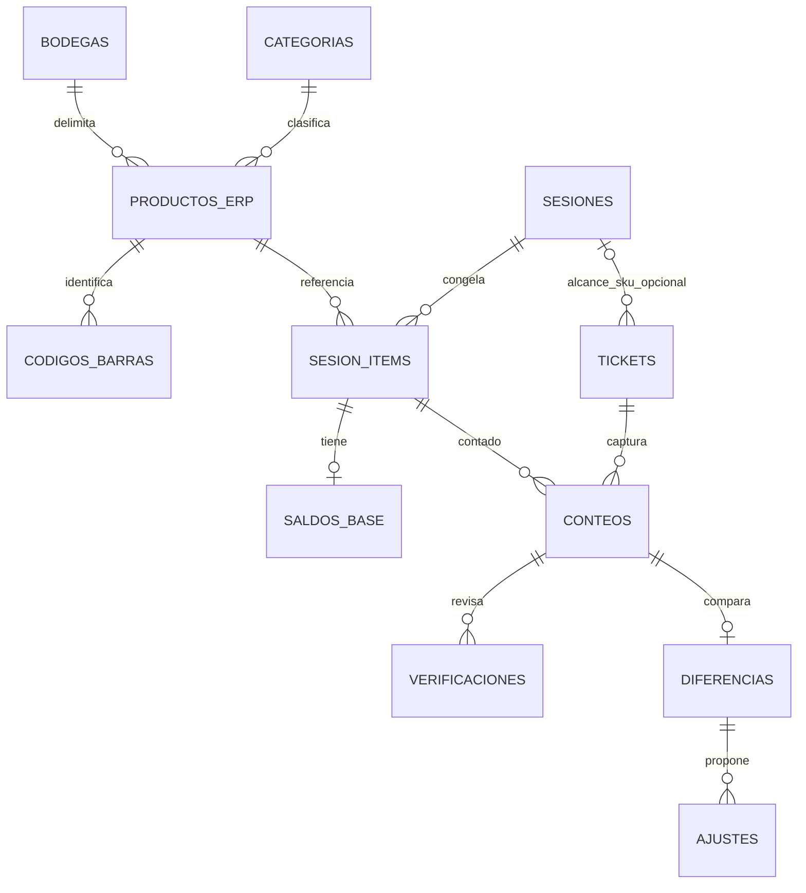

# Intranet Landimotos — Documentación técnica

**Auditoría:** 29 de octubre de 2026, America/Bogota.  
**Referencia Git:** `aa0bf5474ca9aabc06574a2c28d25190324b40b6`, con modificaciones y archivos sin seguimiento anteriores a la auditoría. Las conclusiones corresponden al árbol local inspeccionado, no solo a ese commit.

**Método:** lectura de código/configuración/documentación, análisis de contratos, pruebas locales sin escrituras de negocio y consultas de metadatos de Supabase. El proyecto conectado coincide con la URL declarada localmente como producción. No se ejecutaron migraciones, RPC de negocio, cargas de archivos, cambios de cuentas ni lecturas de registros personales. Los ejemplos son sintéticos. Se conservaron los documentos previos.

El [inventario](INVENTARIO_PROYECTO.md) contiene rutas, catálogo de acciones, diccionario de las 42 tablas inspeccionadas, funciones, restricciones, índices, políticas y consultas reproducibles. El [resumen ejecutivo](RESUMEN_EJECUTIVO.md) y la [documentación comercial](DOCUMENTACION_COMERCIAL.md) explican el alcance empresarial.

## 1. Información general

| Campo | Evidencia y conclusión |
|---|---|
| Nombre | Intranet Landimotos; paquete `intranet_landi-v2.1` |
| Versión | Marca funcional v2.1; paquete privado `0.1.0`. No existe equivalencia de releases demostrada |
| Tipo | Aplicación web interna con frontend y backend Next.js, Auth/Postgres/Storage administrados |
| Propósito | Registro y supervisión de distribución, flota, atención e inventarios |
| Estructura | 142 archivos en `src` al inspeccionar; 15 páginas y un Route Handler explícito |
| Entornos | Desarrollo local, plantillas para desarrollo/producción, lógica para staging y Vercel Preview/Production |
| Aislamiento | El control local detecta que desarrollo usa la base declarada como producción; DEMO comparte infraestructura bajo guardas específicas |
| Estado | Implementación extensa con módulos parciales y G21 pendiente; sin certificación de operación integral |

`README.md` conserva la plantilla de create-next-app. `DOCUMENTACION.md` es anterior al flujo actual de inventarios y contiene afirmaciones de estabilidad y seguridad que no deben utilizarse como prueba vigente. Los documentos especializados de `docs` registran fases distintas; las aclaraciones de esta auditoría tienen fecha y separan estado local, metadatos remotos y antecedentes.

## 2. Stack tecnológico

Versiones contrastadas entre `package-lock.json` y `node_modules`; los rangos declarados están en `package.json`.

| Capa | Tecnología y versión comprobada | Uso |
|---|---|---|
| Framework | Next.js 16.2.4 | App Router, React Server Components, Server Actions, Route Handler y Proxy |
| Interfaz | React / React DOM 19.2.4 | Estado, formularios, componentes y renderizado |
| Lenguaje | TypeScript 5.9.3; JavaScript/SQL/PowerShell auxiliar | Tipado estricto, pruebas Node, funciones PostgreSQL e importación XLSX |
| Estilos | Tailwind CSS y plugin PostCSS 4.2.4 | Utilidades, temas y estilos adaptables |
| Iconos/clases | lucide-react 1.8.0; clsx 2.1.1; tailwind-merge 3.5.0 | Iconografía y composición de clases; instalación no implica uso en todas las pantallas |
| Formularios | react-hook-form 7.73.1; resolvers 5.2.2 | Formularios tradicionales y conexión de validaciones |
| Validación | Zod 4.3.6 | Login, acciones, contratos y entradas de inventarios |
| Supabase | supabase-js 2.104.0; SSR 0.10.2 | Auth, cookies, PostgREST/RPC y Storage |
| Base | PostgreSQL 17; servicio informa versión 17.6.1.084 | Persistencia relacional, RLS, funciones y transacciones |
| Gráficos | Chart.js 4.5.1; react-chartjs-2 5.3.1; Recharts 3.8.1 | Reportes de módulos; existen dos familias de gráficos |
| Imágenes | Sharp 0.34.5 | Decodificar, normalizar y sanear fotografías de conteo |
| Identificadores | uuid 14.0.0; `crypto.randomUUID()`; UUID de PostgreSQL | Archivos, claves de operación y entidades |
| Telemetría | Vercel Analytics 2.0.1; Speed Insights 2.0.0 | Componentes montados en el layout; servicio remoto no verificado |
| Calidad | ESLint 9.39.4; eslint-config-next 16.2.4; `node:test` | Lint y pruebas existentes |
| Runtime de auditoría | Node 22.20.0; npm 10.9.3 | Entorno donde se ejecutaron las verificaciones |

El proyecto no fija una versión de Node mediante `engines` o un archivo de versionado del runtime. Los tipos de Node instalados son 20.19.39. PGlite se utiliza en scripts aislados, pero no está instalado en este `node_modules` ni declarado en el paquete; requiere una carpeta externa de dependencias. No se encontró un ORM, backend independiente, cola de trabajos o servicio de pagos.

Se consultaron las guías instaladas de [Proxy](../node_modules/next/dist/docs/01-app/01-getting-started/16-proxy.md) y [Route Handlers](../node_modules/next/dist/docs/01-app/01-getting-started/15-route-handlers.md). En esta versión la convención activa es `src/proxy.ts`; `src/middleware.ts` aparece eliminado en el árbol local. No debe reintroducirse una convención antigua sin revisar la documentación instalada.

## 3. Arquitectura general

La aplicación es un monolito web con servicios administrados externos. Hay dos estilos de lógica de negocio: acciones TypeScript que encadenan operaciones de tablas en módulos tradicionales y operaciones transaccionales en PostgreSQL para inventarios.



### Capas y comunicación

- **Entrada:** Proxy renueva/valida sesión, comprueba perfil, bloquea inactivos y limita `/admin`. Los layouts vuelven a exigir usuario/perfil. Esto no sustituye autorización en cada acción o en la base.
- **Presentación:** componentes cliente para formularios, filtros y modales; páginas de servidor para acceso y carga inicial de inventarios. `RoleProvider` distribuye el perfil recibido del servidor sin consultar de nuevo desde cada componente.
- **Aplicación:** archivos `actions.ts` con `use server`, servicios `*.server.ts`, esquemas Zod y DTO. Las acciones tradicionales llaman tablas; inventarios utiliza RPC más lecturas protegidas.
- **Dominio:** estados, cantidades, progreso, importación y filtros en TypeScript; autorización por bodega, idempotencia, bloqueos, auditoría y transiciones en funciones SQL.
- **Persistencia:** `public` contiene tablas operativas; `inventario_private` guarda referencias, deduplicación y catálogo DEMO. Storage separa fotos públicas de conductor y evidencias privadas.

### Sesiones, caché y sincronización

`src/utils/supabase/server.ts` obtiene cookies con API asíncrona y crea el cliente SSR. `React.cache` deduplica cliente/usuario/perfil dentro de una solicitud; no es caché compartida entre cuentas. El cliente del navegador usa `createBrowserClient`. `supabaseFetch` transforma fallos 5xx del servicio Auth en errores de transporte recuperables para evitar que el SDK trate una caída temporal como sesión inválida.

Proxy propaga cookies también a redirecciones/errores y marca `private, no-store`. Fallo temporal: 503 con `Retry-After: 30`; sesión inválida: login o 401 JSON para `/api`. El cierre normal de sesión es local a la sesión mediante `signOut({scope:'local'})`.

Inventarios consulta cada 30 segundos mientras la pestaña está visible y hay conexión; el monitor limita una solicitud simultánea, usa timeout de 20 segundos, retroceso exponencial y pausa tras tres fallos. Cada décima actualización solicita catálogo completo; el resto usa categorías de tareas. Mensajeros reutiliza el mismo planificador con sus lecturas operativas. No se encontraron suscripciones Supabase Realtime. Las escrituras de conteo no se reintentan automáticamente.

## 4. Estructura de archivos

| Directorio/archivo | Responsabilidad y relación |
|---|---|
| `src/app/(auth)/login` | Login y validación de credenciales |
| `src/app/(dashboard)/layout.tsx` | Usuario/perfil, proveedor de rol, sidebar y contenido |
| `src/app/(dashboard)/despachos`, `mensajeros`, `vehiculos` | Pantallas, formularios y acciones de cada operación |
| `src/app/(dashboard)/admin` | Usuarios, conductores, atención, campos e inventarios |
| `src/app/(dashboard)/inventarios` | Entrada, tareas, reportes y contenedores |
| `src/app/(print)/inventarios/registros/[ticket]/imprimir` | Impresión dinámica fuera del layout del dashboard |
| `src/app/api/inventarios/monitor/route.ts` | Única API HTTP explícita propia |
| `src/modules/inventarios/operations` | Servicio, acciones, conteos, comparación, evidencias, monitor, impresión y pruebas |
| `src/modules/inventarios/g21` | Contratos y validaciones; adaptador sin transporte |
| `src/modules/inventarios/local` | JSON importado y normalización de histórico Excel |
| `src/modules/inventarios/components` | Primitivas, histórico y pantallas de preparación; algunos componentes ya no están conectados a rutas |
| `src/components/layout`, `theme`, `pwa` | Navegación, temas y registro de worker |
| `src/utils/supabase`, `src/utils/polling.ts` | Clientes, sesión, errores, paginación y actualización periódica |
| `supabase/migrations` | 17 archivos locales; historial no idéntico al remoto |
| `supabase/testing` | Instalador DEMO para entorno de prueba; no ejecutar sobre producción indiscriminadamente |
| `supabase_schema.sql` | Esquema histórico parcial de flota/atención y semillas; no es inicialización completa |
| `scripts` | Verificador de entorno, importadores y pruebas SQL/navegador aisladas |
| `data/inventarios` | XLSX original fuera de `public`; datos internos, no activos públicos |
| `docs` | Documentación de fases, propuestas SQL y evidencias históricas |
| `public` | Iconos, recursos PWA y página offline; contenido accesible sin sesión según Proxy |
| `.local-backups` | Respaldo privado excluido de Git; contenido personal no examinado en esta auditoría |

Convenciones: alias `@/* → src/*`; `use client` marca componentes interactivos; `use server` exporta acciones; `server-only` impide importar servicios privados en el bundle cliente. No hay capa de repositorios uniforme ni tipos generados completos de Supabase. `any`, respuestas inferidas y estructuras locales conviven con contratos estrictos de inventarios.

## 5. Documentación de módulos

### 5.1. Autenticación y perfiles

**Ubicación:** `src/app/(auth)/login`, `src/utils/supabase`, `src/proxy.ts`, `src/hooks/useRole.ts`. Entrada: `FormData` con email/contraseña. `login` valida correo y mínimo seis caracteres, llama `signInWithPassword`, devuelve `{error}` o invalida layout y redirige a `/`. No se implementó alta pública ni recuperación de contraseña en la aplicación.

`requireUser`, `getAuthUser` y `getProfile` obtienen identidad y `perfiles`; `modulos_permitidos` alimenta navegación. `handle_new_user` en la base crea perfil Operativo activo sin módulos, ignora rol enviado en metadata y no reemplaza un perfil existente. `updateUserProfile(id,input)` exige Admin activo, valida nombre/rol/estado y exige que la actualización devuelva una fila. Devuelve `{success:true}` o error; la lectura de usuarios lanza excepción en fallo. El array de módulos admite strings arbitrarios, no una enumeración cerrada.

**Límites:** el estado inactivo se bloquea en la app, pero varias políticas remotas no lo comprueban. No se comprobó configuración efectiva de duración/revocación de sesiones, MFA o alta de Auth. No hay protección local explícita contra quitar el último administrador o desactivar la propia cuenta.

### 5.2. Despachos

**Ubicación:** `src/app/(dashboard)/despachos`. Componentes: `OrderForm`, `ShipmentForm`, `OrderDetailsModal`, `DespachosRecordsTable`, `DespachosAdminStats`. Datos: `pedidos`, `envios`, `mensajeros`, `configuracion_campos`.

`createPedido` recibe punto, factura, área, revisor, mesa, detalles y estado; Zod exige los campos de identificación. `getPedidos` pagina en bloques de 1.000, obtiene el mes y excluye cancelados. `createEnvio` valida UUID de pedido/mensajero, dirección mínima de cinco caracteres y estado; inserta envío y después intenta marcar pedido enviado. `deletePedido` es baja lógica a cancelado. `searchPedidoByFactura` usa coincidencia parcial insensible a mayúsculas y devuelve la más reciente o null. Estadísticas devuelven `{yearly,monthly,hourly}`; `monthly` puede representar cualquier rango.

**Permisos:** visibilidad por rol/módulo en cliente; las acciones no comprueban explícitamente Admin/estado/módulo. La RLS remota de pedidos permite ALL a autenticados. **Errores:** mutaciones devuelven `{success}`/`{error}`; lecturas lanzan; la segunda escritura de envío no comprueba error. Reportes no excluyen cancelados como la lista. Las facturas se almacenan como texto; no hay unicidad fiscal, total monetario o control de duplicación global.

### 5.3. Mensajeros, conductores y rutas

**Ubicación:** `src/app/(dashboard)/mensajeros` y `admin/mensajeros`. `useMensajerosData` combina conductores, rutas activas, configuraciones, finalizadas y almuerzos. `RouteForm` registra destino, pedidos, facturas, revisor y hora opcional. `MessengerForm` mantiene conductor/documentación; `uploadPhoto` guarda en bucket `perfiles` y obtiene URL pública.

**Lecturas:** conductores excepto eliminado; rutas activas; finalizadas y almuerzos creados desde inicio del día del servidor; reportes de finalizadas paginados por período/año. **Escrituras:** crear/editar/baja lógica de conductor, cambio de estado, crear/finalizar ruta, iniciar/finalizar almuerzo. La finalización recibe dos IDs independientes y no verifica en la acción que la ruta pertenezca al mensajero indicado. La creación no verifica en servidor disponibilidad, checklist del día o ausencia de otra ruta activa.

**Validación:** nombres mínimos, UUID en creación de ruta, número de pedidos mínimo uno, factura/destino/revisor no vacíos. Varias actualizaciones reciben únicamente tipos TypeScript, sin validación runtime equivalente. Las fechas documentales se guardan sin validación estricta de fecha por Zod. **Errores:** respuestas convencionales; cambios secundarios de estado en ruta pueden fallar sin impedir éxito. **Permisos:** controles UI y RLS amplia; almuerzos presenta políticas públicas. **Limitación de reporte:** `getMensajerosStats` no selecciona `revisor` ni `hora_llegada`, aunque la exportación las incluye.

### 5.4. Vehículos

**Ubicación:** `src/app/(dashboard)/vehiculos`; `types.ts`, `VehicleForm`, `ChecklistForm`, `VehicleBlueprint`, `ChecklistDetailsModal`, `AlertResolutionModal`, `VehicleStats`. Persiste `vehiculos`, `vehiculo_checklists`, `vehiculo_alertas`.

`createChecklist` exige usuario, UUID de vehículo, identidad de conductor, cargo, kilometraje no negativo y evaluaciones `b/m/na`. Consulta kilometraje actual y rechaza retroceso; cualquier `m` exige observación. Agrupa evaluaciones detalladas en ocho campos históricos y conserva JSONB completo. Inserta checklist, actualiza kilometraje e intenta insertar alerta. Devuelve éxito aunque falle kilometraje/alerta secundarios, con log de error. No hay una transacción común ni bloqueo para kilometraje concurrente. El esquema admite un mapa vacío de evaluaciones; la acción no exige el conjunto completo de ítems mostrado por UI.

`resolveAlerta` marca solucionado y guarda comentarios/fecha. `deleteVehiculo` elimina físicamente; las FK históricas y remotas pueden propagar la eliminación a inspecciones/alertas. Revisar impacto antes de uso. No se ejecutó esa acción. Lecturas de historial permiten fecha/vehículo; no paginan exhaustivamente. RLS permite lectura a autenticados y actualización general de vehículos, no solo al Admin visible en interfaz.

### 5.5. Atención al cliente

**Ubicación:** `src/app/(dashboard)/admin/atencion`. Tabs: registro, WhatsApp, historial, gráficos y configuración. Servicios del mismo `actions.ts`: CRUD de asesores/etiquetas, `get/save/deleteAtencionDiaria`, `get/save/deleteEstadoWhatsapp` y activación de asesor.

Entrada diaria: fecha, asesor, mapa etiqueta→cantidad, total y observación; `saveAtencionDiaria` actualiza por ID o hace upsert por `(fecha,asesor_id)`, con `usuario_id` del usuario si existe. El servidor confía en total/cantidades recibidos; no aplica un esquema Zod ni verifica que el total concuerde con las etiquetas. La UI usa «Clientes atendidos» si encuentra esa etiqueta, o suma valores. Entrada de calendario: fecha, asesor, temática, cantidad, estado y observación. Estado por defecto pendiente; no hay envío externo.

Errores devueltos como texto, incluida colisión 23505; consultas lanzan. La ruta `/admin` se limita por Proxy, pero las acciones no tienen guardas Admin propias. RLS permite INSERT diario y UPDATE de estados a autenticados sin distinguir módulo/propiedad. Las FK hacia asesores usan cascada: borrar un asesor puede eliminar registros relacionados. Los identificadores de etiqueta contenidos en JSONB no tienen FK individual.

### 5.6. Configuración de campos y usuarios

`admin/configuracion/actions.ts` lista, agrega y elimina campos. Zod limita categoría a `area/revisor/mesa` y punto a `Principal/Sucursal`, con valor no vacío. Se invalidan configuración y despachos. RLS permite lectura autenticada y gestión Admin. El código de usuarios se describe en 5.1; no administra cuentas de Auth, contraseñas o sesiones de terceros. Estas operaciones no comparten una auditoría de cambios general.

### 5.7. Inventario operativo por categoría

**Ubicación:** `src/modules/inventarios/operations` y rutas de inventarios. `getInventoryAccess` comprueba perfil activo y módulo, memberships activas en bodegas activas y administrador específico. Distingue `ready`, `denied`, `schema_pending` y `error`; una tabla ausente no se presenta como datos vacíos operativos.

`getOperationData` exige usuario y `inventario_contexto` coherente, consulta tickets `modo=categoria`, categorías, resumen opcional y 20 notificaciones recientes. Los tickets/categorías se paginan por 500. Devuelve `OperationData` con `context`, `categories`, `tasks`, `reconciliations`, `fetchedAt`, `selfStart`, `notifications`; la variante compacta solo carga categorías referenciadas y declara si el catálogo está completo.

`assignInventory` recibe clave UUID, bodega/categoría/operador, prioridad, nota, fuente y productos opcionales. Valida de 1 a 2.000 productos cuando existen, campos de hasta 300 caracteres y nota hasta 2.000. Deriva a `inventario_asignar`, `inventario_asignar_reporte` o `inventario_asignar_con_saldos`. La fuente de prueba resuelve referencias en servidor y no confía en saldos del cliente. SQL valida líder/operador/bodega, usa clave idempotente y transacción.

`saveCountProduct` recibe item, versión positiva y cantidad decimal como string. `getCountProducts` devuelve DTO ciego; `getTaskComparison` devuelve esperado/contado/diferencia únicamente mediante RPC autorizada. `updateInventory` admite iniciar, avance, finalizar, verificar_cerrar o devolver. La revisión requiere nota y delega en `inventario_revisar_conteo`. Los conflictos devuelven `{conflict:true,error}`; `.retry(false)` impide reenvío automático. `getTaskSnapshot` vuelve a leer versión después de productos para evitar combinar lecturas de distintas revisiones.

**UI:** `OperationsPanel` contiene asistente y detalle; `OperatorTaskList` limita al asignado, `LeaderMonitor` agrupa por estado/operador/tabla y `InventoryOverview` resume. Reportes muestran tiempos, coincidencias, faltantes, sobrantes y cierres con diferencias. `getTaskEvents` limita historial a líder/administrador de la bodega, con lectura paginada. `TeamPanel` es consulta; no tiene acciones para modificar miembros.

### 5.8. Evidencias y observaciones

`evidence.actions.ts` exige sesión y lectura del ticket antes de firmar fotos. Para editar, exige operador asignado, rol operador y estado en proceso. `getEvidence` consulta metadatos con RLS y firma URLs por 300 segundos usando cliente servidor privilegiado. Sin clave privada puede consultar metadatos/observaciones, pero la carga no está habilitada.

`uploadEvidence(FormData)` recibe `ticket`, UUID `id` y `file`. Límite 5 MiB y 24 megapíxeles; acepta JPEG/PNG/WebP sin animación. Sharp decodifica, orienta y convierte a WebP, eliminando metadata EXIF/GPS; calcula SHA-256. Reserva mediante RPC de usuario, sube con `upsert:false` y confirma mediante RPC reservada al servidor. La base limita tres reservas activas por tarea y hash no repetido. Ante fallo comprueba si ya se confirmó; en otro caso intenta limpiar objeto/reserva, sin ocultar pendientes.

`deleteEvidence` marca eliminación, retira objeto por Storage API y confirma estado eliminado conservando metadata. `saveCountNote` admite hasta 2.000 caracteres y versión no negativa. El trigger impide entregar con cargas/eliminaciones pendientes. No hay limpieza periódica de huérfanos implementada; soporte debe inspeccionar estados y rutas con acceso autorizado. La plantilla de producción no enumera la clave de Storage aunque el código la necesita: documentarla en el aprovisionamiento del servidor.

### 5.9. Autoinicio DEMO

`demo-environment.ts` exige ambiente development/staging y rechaza Production; verifica destino, flags y fuente. El uso del proyecto compartido requiere `INVENTORY_DEMO_SHARED_PROJECT_REF` y una clave privada hexadecimal de 64 caracteres en desarrollo. `demo-source.server.ts` solicita contexto/catálogo/creación con cabecera privada. La base compara hash y luego aplica identidad, bodega, rol y permisos normales.

`getBlindCatalog` valida bodega/categoría. `createOwnInventory` valida además subcategoría/marca, clave, nota e IDs (1–2.000), y rechaza campos adicionales. PostgreSQL exige que los IDs coincidan con el alcance filtrado, copia los productos privados y marca `es_prueba`. La pantalla `NewInventory` mantiene clave y alcance en reintentos. La tarea comienza en proceso y usa el flujo de revisión existente. El autoinicio oficial conectado a G21 no está habilitado.

### 5.10. Histórico Excel, impresión y contenedores

**Excel:** `local/source.server.ts` solo entrega histórico a perfil Admin activo con capacidad de configuración. `normalizeExcel` conserva origen/fila, trata blancos como ausentes, interpreta fechas Excel y aplica dos correcciones explícitas condicionadas a hoja/fila/categoría/valor anterior. Hash XLSX/JSON coincide; normalización comprobada: seis hojas, 184 registros y 793 categorías. La consulta histórica actual está dentro de `/inventarios/reportes`; el documento antiguo que la sitúa como vista principal de registros está desactualizado.

**Impresión:** `getDifferencePrintData` valida UUID, usuario, contexto y rol líder/administrador en la bodega; usa snapshot/comparación, unidades y doble verificación de versión/cardinalidad. `DifferencePrintPreview` abre el diálogo del navegador con A5/A4. Solo imprime diferencias no cero; ausencia de referencia no se declara coincidencia. No escribe ni almacena PDFs. Los errores se renderizan en la página; el componente no fija por sí mismo un 403 HTTP.

**Contenedores:** CRUD en `inventarios/actions.ts`, formulario y `ContainersView`, ahora en `/inventarios/contenedores`. Zod valida código mínimo tres y estado. Baja lógica a mantenimiento. Solo se invalida `/inventarios`, pese a existir una ruta específica. RLS remota sin políticas bloquea la operación ordinaria; una lista vacía no demuestra ausencia real de contenedores y un UPDATE de cero filas puede anunciar éxito porque no verifica retorno.

### 5.11. Integración G21 y componentes de preparación

`g21/contracts.ts` define bodegas, categorías, producto/unidad/código de barras, snapshot, movimientos y errores. `validation.server.ts` valida cadenas decimales, fechas UTC, cursores, completitud, duplicados, alcance y proyección ciega; `assembleStockSnapshot` exige un corte consistente y completo. `getG21ReadAdapter` devuelve `G21_INTEGRATION_PENDING` en todos los métodos y no usa red.

Los contratos `G21ApprovedAdjustment` y `ScanCapture` no constituyen una integración de ajustes o cámara. El buscador de productos de la UI puede recibir texto de un lector que funciona como teclado, pero no convierte unidades automáticamente. `InventoryConfiguration` muestra preparación para catálogo/permisos/alertas; `InventoryRecords`, `InventoryReports` y `GlobalAdminStats` no tienen importadores de producción encontrados. No deben contabilizarse como rutas funcionales adicionales.

## 6. Base de datos

### 6.1. Fuentes y alcance

Se contrastaron SQL local, migraciones y metadatos remotos de `public`, `inventario_private`, triggers de `auth.users`, políticas de `storage.objects` y configuración de buckets. Se comprobaron **36 tablas públicas, 6 privadas, 53 funciones en public/inventario_private y ausencia de vistas ordinarias en esos dos esquemas**. No se obtuvo un dump de registros ni una copia de secretos. El diccionario completo está en el inventario; incluye columnas, tipos, nulabilidad, PK/FK, checks y restricciones.

### 6.2. Modelo operativo

| Grupo | Tablas | Relaciones y reglas importantes |
|---|---|---|
| Identidad | `perfiles` | PK/FK a `auth.users.id`; email único; rol/estado con checks; módulos text[] |
| Distribución | `pedidos`, `envios`, `mensajeros`, `mensajeros_rutas`, `mensajeros_almuerzos`, `configuracion_campos` | Envío referencia pedido/mensajero; rutas/almuerzos referencian mensajero. Facturas de rutas son texto, no FK a pedidos |
| Flota | `vehiculos`, `vehiculo_checklists`, `vehiculo_alertas` | Placa única; checklist referencia vehículo/perfil; alerta referencia checklist, vehículo y perfil |
| Atención | `atencion_asesores`, `atencion_etiquetas`, `atencion_diaria`, `atencion_estados_whatsapp` | Nombres de catálogos únicos; registro diario único por fecha/asesor; etiquetas de registro en JSONB |
| Contenedores | `contenedores` | Código único; estados con check; sin movimientos ni responsables asociados |
| Acceso de inventario | `inventario_bodegas`, `inventario_usuarios_bodegas`, `inventario_administradores`, `inventario_categorias` | Miembro único perfil/bodega; responsable activo único por bodega; códigos ERP/referencias locales diferenciados |
| Conteo por categoría | `inventario_tickets`, `inventario_tarea_productos`, `inventario_private.referencias_producto` | Ticket categoría, operador y líder; producto único ticket/código; referencia privada por producto de tarea |
| Seguimiento | `inventario_auditoria`, `inventario_notificaciones`, `inventario_evidencias`, `inventario_observaciones_conteo`, `inventario_private.operaciones` | Eventos, destinatarios, estados de foto, nota versionada y clave idempotente única |
| DEMO | `demo_entorno`, `demo_bodegas`, `demo_productos`, `demo_tickets` en esquema privado | Marca de entorno, autorización por bodega, referencias simuladas y procedencia del ticket |

### 6.3. Modelo preparado para ERP

`inventario_productos` y `inventario_codigos_barras` modelan catálogo, unidad base y factor de conversión. `inventario_sesiones` y `inventario_sesion_items` representan una fotografía de alcance/corte; `inventario_saldos_base` separa la referencia. `inventario_conteos`, `inventario_verificaciones`, `inventario_diferencias` e `inventario_ajustes` preparan conteo versionado, conciliación y aprobación. `inventario_parametros` y `inventario_sincronizaciones` reservan reglas de antigüedad y registro de integración.

Estas tablas existen, pero no acreditan ejecución de sincronizaciones ni envío de ajustes. Las tareas activas de la aplicación usan `modo='categoria'` y pueden no tener sesión ERP. Las FK compuestas mantienen consistencia entre bodega, categoría, sesión e ítem. Los `numeric` y columnas generadas conservan aritmética decimal; no debe reemplazarse por float del navegador.



Los nombres simplificados del diagrama se corresponden con las tablas anteriores. No se dibuja una relación pedido→ruta porque no existe una FK que la garantice.



Segundo diagrama: estructura existente para integración futura, no un flujo ERP operativo verificado.

### 6.4. Restricciones, índices, triggers y políticas

Inventarios combina checks de estados/roles/orígenes, cantidades y factores; PK/FK compuestas; unicidad de clave idempotente; número de ticket; producto por ticket/código; un responsable activo por bodega; un conteo activo por sesión; hash de evidencia no eliminada; destinatario/evento de notificación. Los detalles exactos remotos se conservan en el inventario.

Existen índices por bodega/estado/fecha, asignado/estado, ticket de auditoría/evidencia, categorías y actores. En las tablas tradicionales se observaron principalmente índices de claves/únicos: la existencia de índices sugeridos en `supabase_schema.sql` no demuestra que estén desplegados. La migración de índices de estabilidad no figura en el historial remoto consultado.

Triggers principales: `on_auth_user_created`, actualización de timestamps de inventario, validación de resultados, bloqueo de entrega con evidencias pendientes, prevención de autoinicio duplicado, notificación de autoinventario, protección del origen DEMO y bloqueo de cierre oficial sin conciliación. No se observaron triggers que hagan atómicas las escrituras tradicionales de pedido/envío, ruta/estado o checklist/alerta.

Todas las tablas inspeccionadas tienen RLS. Eso no significa acceso correcto: las políticas permisivas se combinan y varias permiten acceso amplio. Las tablas privadas sin políticas y sin grants de cliente constituyen aislamiento deliberado; `contenedores` sin políticas impide su operación. En Storage, la política de bloqueo directo de `inventario-evidencias` es **RESTRICTIVE**, a diferencia de las políticas públicas de `perfiles`.

### 6.5. Migraciones y reproducibilidad

| Situación | Archivos/entradas |
|---|---|
| Locales con nombres presentes remotamente | 14 nombres de migración |
| Diferencia de versión para evidencias | Local `20261021153718`; remoto `20261021161517` |
| Diferencia de versión para verificar/cerrar | Local `20261021164401`; remoto `20261021164715` |
| Sin entrada remota equivalente | `20261021140335_inventarios_prioridades_tres_niveles`, `20261021143932_inventarios_autoiniciados`, `20261022144854_estabilidad_indices_lectura` |

Parte de los campos/funciones de autoinicio sí existe mediante migraciones DEMO posteriores. Ausencia de una entrada histórica no equivale a ausencia de toda su funcionalidad. No ejecutar un `db push` general ni reaplicar versiones por nombre parecido: comparar definición, dependencia y finalidad antes de preparar una secuencia coherente. El SQL inicial depende de entidades tradicionales que no están completamente creadas en el repositorio. Por tanto, instalar una base vacía no es hoy un procedimiento autónomo reproducible.

## 7. APIs e integraciones

### 7.1. HTTP propio

| Método y ruta | Autenticación/entrada | Respuesta y errores | Responsable |
|---|---|---|---|
| `GET /api/inventarios/monitor` | Cookies de sesión; perfil/módulo vía RPC. Query `reports=true` y `compact=true`; cualquier otro valor equivale a false | 200 `OperationData`; 401 sesión; 403 alcance; 503 fallo. `Cache-Control: private, no-store`; error con `Retry-After: 30` | `src/app/api/inventarios/monitor/route.ts`, `service.server.ts`, Proxy |
| `GET /inventarios/registros/[ticket]/imprimir` | Sesión, UUID, rol supervisor y bodega del ticket | HTML de impresión o mensaje de error; no JSON/PDF remoto. Proxy puede redirigir/emitir 503 antes | Página del grupo `(print)` y `difference-print.server.ts` |
| `GET /manifest.webmanifest`, `/sw.js`, `/offline.html` | Recursos públicos, sin parámetros de negocio | Manifiesto, worker y pantalla offline | `manifest.ts`, `public`, `next.config.ts` |

No se encontraron otras rutas `route.ts` de negocio. Los fragmentos `#reportes` son selección de vista cliente, no endpoints. Métodos no implementados del Route Handler reciben el comportamiento 405 del framework.

Ejemplo ilustrativo de monitor autorizado:

```http
GET /api/inventarios/monitor?reports=false&compact=true
Accept: application/json
```

El navegador adjunta su sesión; no se publica un token. Forma abreviada de respuesta posible para un alcance sin tareas:

```json
{
  "context": {"userId":"00000000-0000-4000-8000-000000000001","globalAdmin":false,"warehouses":[],"members":[],"people":[],"users":[]},
  "categories": [], "catalogComplete": false, "tasks": [],
  "reconciliations": [], "fetchedAt": 1793278800000,
  "selfStart": {"enabled":false,"warehouses":[],"categories":[],"source":"demo","reason":"Destino de pruebas pendiente de validar."},
  "notifications": []
}
```

El texto exacto de `reason` depende del entorno. En error del handler: `{"error":"No se pudo actualizar el inventario."}`; Proxy puede responder antes con `code: SESSION_INVALID` o `SERVICE_UNAVAILABLE`.

### 7.2. Server Actions

Son contratos internos invocados por React/Next mediante POST generado por el framework; no existe una URL REST estable por función ni una API pública versionada. Deben autorizar por sí mismas aunque se oculten botones. El [inventario de acciones](INVENTARIO_PROYECTO.md#4-contratos-de-acciones-de-servidor) lista **69 funciones exportadas** y sus parámetros. No interpretar un `{success:true}` como HTTP 201 ni `{error}` como HTTP 400: la aplicación usa resultados serializados, excepciones y redirecciones.

| Familia | Contrato de entrada y validación | Salida/errores principales |
|---|---|---|
| Login | `FormData`; email y contraseña mínima | Error Auth/validación o redirección |
| Perfiles | ID + nombre, rol, estado, módulos | Filas; success/error; denegación de Admin activo |
| Pedidos/envíos | Esquemas Zod; UUID y dirección para envío | Filas/estadísticas; success/error; sin transacción conjunta |
| Mensajeros/rutas | Datos de conductor/ruta; IDs en cambios; File para foto | Filas/estadísticas/URL pública; success/error |
| Vehículos/checklists | Datos de vehículo; evaluación y kilometraje | Filas/contadores; errores de campo y de base |
| Atención/campos | Payload de registro/calendario; Zod solo en campos | Filas; success/error; validación servidor incompleta en atención |
| Conteos | UUID, versión y decimal string; nota ≤2.000 | `{ok:true}` o `{error,conflict}`; DTO de productos/comparación/eventos |
| Evidencias | UUID, File ≤5 MiB; nota/version | Metadata/URLs temporales; enabled/uploadsEnabled; ok/error/conflict |
| DEMO | Bodega/categoría/filtros/IDs/clave, objeto estricto | Catálogo ciego o ticket; error sin alterar navegación |

Ejemplo ilustrativo de entrada de `saveCountProduct`: `{"item":"00000000-0000-4000-8000-000000000002","version":3,"quantity":"0.125000"}`. Éxito: `{"ok":true}`. Conflicto: `{"conflict":true,"error":"La tarea cambió. Actualiza antes de continuar"}`. La cantidad es texto decimal; vacío no es cero.

### 7.3. Supabase RPC y Data API

Las consultas de tabla utilizan PostgREST; las RPC públicas se sirven bajo `/rest/v1/rpc/<nombre>` por el SDK. No se llamaron operaciones mutantes para esta auditoría. Las funciones públicas de inventarios usan `SECURITY INVOKER` y delegan en funciones privadas controladas, habitualmente `SECURITY DEFINER` con `search_path` vacío.

| RPC | Parámetros principales | Resultado/finalidad |
|---|---|---|
| `inventario_contexto` | Ninguno | JSONB de identidad, bodegas, miembros y personas autorizadas |
| `inventario_asignar` | clave, bodega, categoría, operador, prioridad, vencimiento, observación | UUID de ticket por categoría, idempotente |
| `inventario_asignar_reporte` | Anteriores sin vencimiento + productos JSONB | Ticket con productos, sin referencias |
| `inventario_asignar_con_saldos` | Anteriores + productos y es_prueba | Ticket con referencias privadas |
| `inventario_actualizar` | ticket, versión, acción, avance, nota | Transición; devuelve void |
| `inventario_productos_tarea` | ticket | Productos/contado/unidad/códigos; sin referencia |
| `inventario_contar_producto` | item, versión, cantidad text | Guarda conteo y auditoría; void |
| `inventario_comparacion_tarea` | ticket | Esperado, contado, diferencia y resultado para supervisión |
| `inventario_resumen_conciliacion` | Ninguno | Totales por ticket; referencia fija, no movimientos ERP |
| `inventario_revisar_conteo` | ticket, versión, acción, nota | Cierre o devolución transaccional; void |
| `inventario_evidencia_editar` | ticket, id, acción, nombre, hash, bytes | Reserva/eliminación autorizada y metadata |
| `inventario_evidencia_confirmar` | id, acción | Confirmación privilegiada; no ejecutable por anon/authenticated |
| `inventario_observacion_guardar` | ticket, texto, versión | Guarda observación y versión |
| `inventario_demo_contexto` | Ninguno + cabecera privada servidor | Habilitación, bodegas/categorías y metadata de tickets |
| `inventario_demo_catalogo` | bodega, categoría + cabecera | Productos ciegos DEMO |
| `inventario_demo_autoiniciar` | clave, bodega, categoría, observación, IDs | Creación completa; compatibilidad |
| `inventario_demo_autoiniciar_filtrado` | Anteriores + subcategoría/marca | Creación validada del grupo filtrado |
| `inventario_miembro` | bodega, perfil, rol, activo | Función antigua de aprovisionamiento; permiso cliente revocado |

Errores relevantes: `42501` acceso denegado; `P0001` regla de negocio; `PT409` con detalle `INVENTORY_VERSION_CONFLICT`; `23505` unicidad; `42P01/PGRST205` tabla ausente; `42883/PGRST202` RPC ausente. El cliente también reconoce `40001` por compatibilidad, pero no debe generarlo como conflicto de versión de negocio: PostgreSQL/PostgREST lo puede tratar como serialización reintentable. No confundir ese reconocimiento con autorización para repetir escrituras.

### 7.4. Servicios externos

| Integración | Uso real | Estado/límite |
|---|---|---|
| Supabase Auth/Postgres | Sesiones, tablas, RLS y RPC | Metadatos accesibles; operaciones reales no ensayadas |
| Supabase Storage | Fotos públicas de conductor y evidencias privadas | Buckets/políticas comprobados; sin subir/retirar objetos reales |
| Vercel | Destino informado en antecedentes y paquetes de telemetría | No se inspeccionaron variables, release activo, dominios ni plan |
| Google Fonts mediante next/font | Geist y Geist Mono en layout | Build puede necesitar acceso al proveedor de fuentes |
| XLSX/CSV | Importación administrativa y reportes manuales | No sincronizan automáticamente con el archivo/ERP original |
| G21 | Puerto y contratos internos | Pendiente; no endpoints oficiales confirmados ni tráfico implementado |
| WhatsApp | Nombre de calendario y tareas | No SDK, webhook, envío ni recepción de mensajes |

Supabase no reportó Edge Functions en el proyecto consultado. En extensiones instaladas no apareció `pg_cron`; no se encontró programador de negocio en el repositorio. Esto no descarta automatizaciones externas ajenas a lo inspeccionado.
